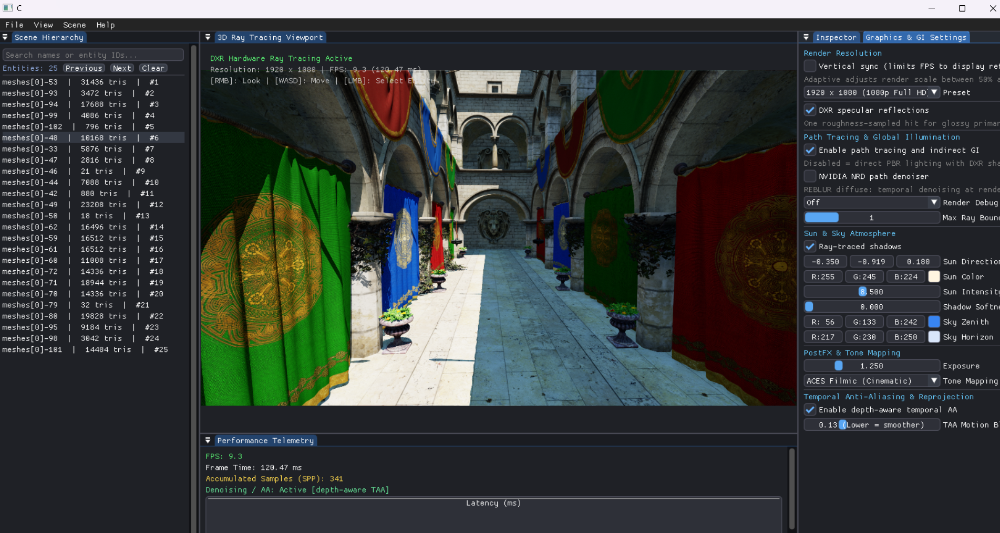
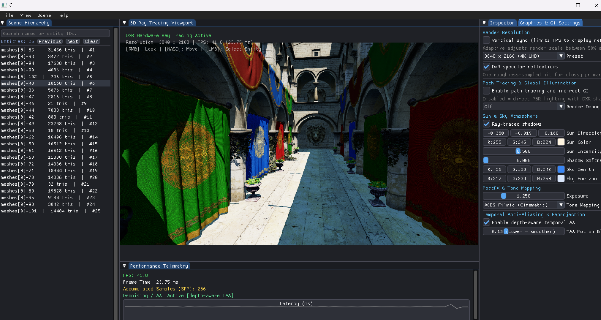
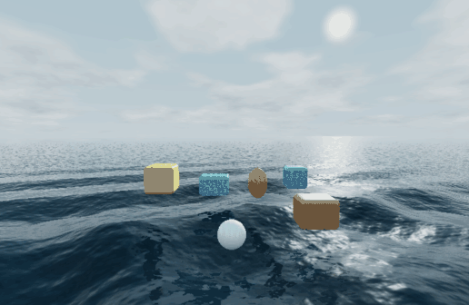

# Custom DX12 Ray-Tracing Engine

A Windows C++20 Direct3D 12/DXR editor and renderer for the Sponza atrium, with a separate Jolt-driven ocean demonstration. 

The renderer favors a fast direct-lighting mode for interaction and provides a slower progressive path-tracing mode for indirect lighting. O3DE Atom DX12 acceleration-structure code is credited below where its BLAS/TLAS organization informed the local implementation.

## Implemented Features

| Feature | Status in this engine | Scope and validation |
| --- | --- | --- |
| Direct lighting and shadows | Implemented | PBR material response, one directional sun, analytic sky, DXR shadow rays, adjustable soft-shadow sampling. Exercised by Sponza capture stages 2–3. |
| DXR specular reflections | Implemented | Editor toggle in **Graphics & GI Settings**; one bounded, roughness-sampled reflection query for eligible glossy primary surfaces. It is exercised on Sponza, an official Khronos glTF metal/roughness sample, and the ocean. The bundled Sponza's missing roughness/metalness maps now use conservative dielectric fallbacks; its horizontal stone floor gets a polished-stone fallback so its DXR reflection is visible. |
| Path-traced global illumination | Implemented | Progressive diffuse path tracing with a configurable 1–4 secondary-bounce limit, cosine sampling, and low-discrepancy per-pixel Sobol/Owen sampling. GI is substantially slower than direct mode. |
| Denoising | Implemented when built with NRD | NVIDIA NRD REBLUR diffuse denoising is available in the default build. Without NRD, samples are progressively accumulated and a depth/luminance-aware 9-tap filter is applied to display radiance only; the raw estimator remains in history, so filtering does not recursively blur later frames. The Sponza capture suite passes in both configurations. |
| Temporal AA and reprojection | Implemented | Depth-aware temporal accumulation and camera reprojection are used by the renderer; the moving-camera capture exercises this path. The moving ocean disables temporal accumulation to avoid trails. |
| Texture filtering | Implemented | Sponza texture arrays have linear-light mip chains; DXR hit shaders estimate ray-cone mip levels for base color and alpha-cutout textures. |
| Post-processing | Partial | Exposure and ACES, Reinhard, or linear tone mapping are available. NRD and temporal AA are the temporal image-quality features. There is no bloom, depth of field, motion blur, or general post-effect stack. |
| Ocean and buoyancy | Demonstration | Six Jolt bodies sample an analytic wave field. Fixed-step entries pin radial wave origins; those waves feed subsequent buoyancy impulses, while body vertical speed adds contact waves and shading adds multiscale detail, foam, Fresnel, GGX glints, and one-bounce environment/object reflection. The water remains a flat DXR intersection proxy rather than displaced geometry; this scene is separate from Sponza. |
| ECS hierarchy and Inspector | Implemented | Name/ID filtering, filtered Previous/Next selection, viewport ray picking against transformed world-space mesh bounds, transform editing, and per-entity material overrides. The picker uses AABBs, so it can select empty space inside a mesh's bounds. |
| RTXDI/ReSTIR, RTXGI, RTXPT | Reference sources only | Source trees are preserved under `vendor/nvidia/` with their license files. These SDKs are not linked into the running renderer. In particular, ReSTIR needs reservoir storage and temporal/spatial reuse passes that this renderer does not implement. |
| RTXMG, RTXMU, RTXNTC | Not present or integrated | These SDKs are not dependencies of the current executable and are not included in the checked-in vendor source tree. |
| Skeletal animation and full O3DE Atom systems | Not implemented | The current scene path renders static mesh instances. It does not include an animation playback/skinning system, Atom material pipeline, or full O3DE lighting/post-processing stack. |

## Render Captures

The screenshots below are user-provided editor captures. They show the current Sponza path-tracing settings at 1920×1080 and direct PBR/DXR at 3840×2160; the FPS values are the editor overlay at capture time, not repeatable benchmark results.





The following water preview is captured from the 60 Hz Jolt simulation at 30 frames per second. Its wave height/normal changes are analytic shading on a flat ray-hit proxy, not geometric water displacement.



The **DXR specular reflections** checkbox controls the same reflection path in Sponza, the Khronos material lab, and the ocean. It skips reflection traversal while disabled. Eligible primary materials trace at most one secondary hit; reflected-hit shading does not recurse. The bundled Sponza package has all 25 base-color images but none of its 24 referenced metallic/roughness images. Missing maps previously became white texture layers, which incorrectly made the affected materials fully metallic and hid diffuse response. The importer now applies a conservative dielectric fallback (`metallic=0`, `roughness=0.65`) and a localized polished-stone fallback (`roughness=0.30`) to Sponza's horizontal floor material. This is a documented fallback, not a substitute for restoring the authored maps. In the latest exact 1920×1080 Sponza on/off capture, toggling DXR changed 48.50% of pixels (0.544 mean channel delta) at 129.59/128.53 FPS; short-window FPS varies with GPU scheduling. Water still reflects the analytic sky when DXR is disabled; that is the inexpensive environment fallback. Use `python reflection_capture_runner.py --scene all` and `python ocean_capture_runner.py --compare-reflections` to repeat these checks.

## Requirements

- Windows 10/11 x64, Visual Studio 2022 C++ tools, Windows SDK, CMake, and Python 3.
- A Direct3D 12 GPU with hardware DXR Tier 1.0 or newer. The shader library is compiled as HLSL 6.5.
- DXC (`dxc.exe`) discoverable from the installed Windows SDK.
- MSYS2 MinGW64 Assimp and MSYS2 UCRT64 Jolt. Defaults are `C:/msys64/mingw64` and `C:/msys64/ucrt64`; override them at configure time if installed elsewhere.
- The Jolt bridge is compiled with AVX2 and related x64 CPU extensions. The target CPU must support AVX2. The build stages Jolt and its UCRT64 runtime beside the executable.
- CMake 3.30 or newer for the default NRD-enabled build. NRD/NRI are NVIDIA's denoising/integration SDKs; this option can be disabled to build without them.
- Pillow is optional and only needed to rebuild the curated 30 FPS README GIF from the dense BMP sequence (`python -m pip install Pillow`).

## Build

Run these commands from this project directory in a Visual Studio Developer PowerShell. Adjust the MSYS2 roots if needed.

```powershell
cmake -S . -B build -G "Visual Studio 17 2022" -A x64 `
  -DASSIMP_ROOT=C:/msys64/mingw64 `
  -DJOLT_ROOT=C:/msys64/ucrt64 `
  -DENGINE_ENABLE_NRD=ON
cmake --build build --config Release --parallel
```

The normal build stages both `build/Release/CustomEngine.exe` and `build/Release/WaterDemo.exe`. To rebuild/stage just the water entry point explicitly, use `cmake --build build --config Release --target WaterDemo`.

To build without NRD/NRI, configure a separate build directory with the same generator and `-DENGINE_ENABLE_NRD=OFF`, then build that directory. The NRD-off Release build was also compiled and passed the Sponza capture suite. The default build places the executable at `build/Release/CustomEngine.exe` and stages assets and runtime DLLs beside it. Launch from the project directory so relative asset paths resolve:

```powershell
build\Release\CustomEngine.exe
```

The editor opens in direct PBR + DXR shadows mode for faster interaction. Use **Graphics & GI Settings** to enable path tracing/GI, toggle NRD, adjust bounce count, shadows, sun/sky, exposure, tone mapping, TAA, and render resolution. The `Adaptive (target 60 FPS)` preset adjusts the viewport render scale between 50% and 100%; 1080p/4K fixed modes can be much slower, especially with path tracing.

`build/Release/WaterDemo.exe` starts directly in the interactive Jolt ocean scene. It is staged beside `CustomEngine.exe` and uses the same editor, renderer, assets, and runtime DLLs. From the project root, run `build\\Release\\WaterDemo.exe`; use the editor's **Scene** menu to switch between the ocean, Sponza, and the Khronos reflection lab. `CustomEngine.exe` continues to start in Sponza. The automated `--ocean-test` command remains a separate fixed-duration capture mode.

Camera controls are shown in **Help**: WASD to move, Space/E to ascend, Ctrl/Q to descend, Shift to sprint, hold right mouse to look, and left-click the viewport to select an entity.

## Automated Checks

The runners launch the executable from this directory and refresh generated images in `captures/`.

```powershell
python capture_runner.py
python capture_runner.py --native-resolution
python capture_runner.py --no-nrd
python ocean_capture_runner.py
python ocean_capture_runner.py --no-reflections
python ocean_capture_runner.py --compare-reflections
python ocean_capture_runner.py --gif-30fps
python tools/build_ocean_gif.py
python reflection_capture_runner.py --scene all
```

The Sponza runner validates eight fresh captures: path-traced GI, direct DXR shadows, golden-hour lighting/three-bounce GI, Reinhard exposure, normals, the full editor UI, moving-camera TAA/reprojection, and a material-upload regression image. That last stage edits entities through the scene material API, requires a GPU upload log entry, and requires at least 10% of sampled pixels in the capture to show the test color. It also checks BMP structure, dimensions, freshness, and nonblank image samples.

The ocean runner checks a fresh 688×448 capture, hardware DXR dispatch, six Jolt bodies, at least 5.9 seconds of simulation, measured vertical body movement, final body centers near the water, and blue-water pixels. `--sequence` additionally checks repeated entries and a temporal color change across water pixels common to frames 90 and 180. `--gif-30fps` captures every second 60 Hz simulation step (166 BMPs); `tools/build_ocean_gif.py` combines those into the curated README preview. Reflection on/off/on compares fresh captures and leaves the reflection-enabled result in place.

The reflection runner uses fixed camera/sample settings and compares fresh on/off/restored captures. It also checks the device's DXR tier and `DispatchRays` log, and rejects an on-state FPS below 55% of the off-state measurement. Latest Sponza result: 0.544 mean channel delta / 48.50% changed pixels at 129.59/128.53 FPS on/off at 1920×1080. The previous Khronos Metal/Rough Spheres result was 2.447 / 59.73% at 181.50/153.36 FPS. These short-window averages vary with GPU scheduling; the Sponza capture confirms an active DXR path, not mirror-like behavior on every rough surface.

## Measured Performance

Latest Release test measurements on an NVIDIA GeForce RTX 3050 Laptop GPU (Windows, 2026-10-16):

| Test mode | Render size | Measured average |
| --- | ---: | ---: |
| Direct + DXR shadows, NRD build | 960×544 | 296.3 FPS |
| Path-traced GI with NRD | 960×544 | 44.2 FPS |
| Direct mode, NRD disabled build | 960×544 | 298.2 FPS |
| Path-traced GI, NRD disabled build | 960×544 | 47.5 FPS |
| Ocean + Jolt, DXR reflection enabled | 688×448 | 419.2 FPS |

These values are averages over the runner's designated steady-state frames, not guaranteed game frame rates. They vary with driver state and hardware load. Native-resolution GI remains the main performance bottleneck; use direct mode or adaptive/lower resolution for interactive work.

## Project Layout and Generated Files

- `src/` — scene/ECS, DX12/DXR renderer, denoiser bridge, editor, Jolt bridge interface, and tested analytic water-wave math.
- `shaders/` — DXR path tracing, water, and NRD composition shaders.
- `assets/sponza/` — Sponza glTF scene and textures.
- `tools/` — DXIL embedding, runtime staging, Jolt C ABI bridge build source, and optional water GIF encoder.
- `vendor/` — ImGui, cgltf, stb, and NVIDIA source snapshots with their license/notice files.
- `captures/` — test output BMPs; ignored by Git because the runners regenerate them.
- `docs/media/` — curated screenshots and the 30 FPS water GIF embedded in this README; these files are intentionally not ignored.
- `ENGINE_CHECKPOINT.md` — dated engineering notes, faults found, changes, and test results.

The root `.gitignore` excludes build/validation directories, Python caches, generated captures, local ImGui state, test bitmaps, and local logs. It does not ignore engine source, vendored source/licenses, assets, test runners, or curated `docs/media/` assets.

## Renderer Architecture

```text
Win32 window + ImGui editor
        |
        +-- scene selection / hierarchy / inspector / graphics controls
        |
        v
Assimp glTF import ---------------------> cgltf fallback
        |                                      |
        +------ mesh/material/texture data <---+
        |     (CPU arrays, mip chain, material/instance tables)
        v
Per-mesh BLAS  ---> per-frame instance descriptors ---> TLAS
                                                        |
SceneCB + TLAS + vertex/index/material/texture SRVs -----+
                                                        v
DXR state object + shader binding table -> DispatchRays(W,H,1)
        |
        +-- RayGen: camera ray, sample stream, bounce loop
        |      +-- TraceRay(primary)
        |      |      +-- AnyHit: alpha-cutout texture test
        |      |      +-- ClosestHit: PBR, optional shadow TraceRay
        |      +-- cosine-sampled indirect rays (GI mode)
        |      +-- one bounded reflection TraceRay (eligible glossy primary hits)
        |
        +-- direct/debug output OR progressive history
        +-- optional NRD REBLUR diffuse -> local composition pass
        +-- output texture -> ImGui viewport -> swap-chain present

Ocean scene only:
Jolt C++ bridge -> fixed-step wave buoyancy -> ECS transforms -> updated TLAS
```

Sponza loads through Assimp first, then cgltf if Assimp rejects the asset. Imported submeshes are flattened into shared CPU vertex/index/material arrays, converted to GPU buffers, and associated with BLAS instances. The texture path creates a texture array and mip chain; DXR hit shaders estimate an explicit mip from triangle world area, UV area, hit distance, camera FOV, and render height. The top-level structure carries per-entity transforms and instance indices used to look up material data.

The hardware path is capability-gated. Device startup enumerates non-software adapters, creates an `ID3D12Device5`, checks `D3D12_FEATURE_D3D12_OPTIONS5::RaytracingTier`, and requires Tier 1.0 or newer. Pipeline startup creates a DXR state object and shader table. The frame loop binds that state object with `SetPipelineState1` and records `DispatchRays`; HLSL contains primary, shadow, GI, water-reflection, and PBR-reflection `TraceRay` paths. The editor checkbox writes the scene constant buffer that gates the reflection queries. The primary-material path only traces for sufficiently metallic/polished materials, and uses a single secondary hit whose material shader is marked to prevent further reflection recursion. Test logs report the selected adapter tier and first dispatch; capture runners also compare images with the toggle on and off.

## Lighting and Sampling Equations

For each opaque surface the shader uses a Cook–Torrance form with GGX normal distribution, Smith masking-shadowing, and Schlick Fresnel:

```text
Lo = (kd * albedo / pi + D_GGX * G_Smith * F / max(4 * NoV * NoL, epsilon))
     * sunRadiance * NoL * shadowVisibility + emissive + skyAmbient
F  = F0 + (1 - F0) * (1 - VoH)^5
kd = (1 - F) * (1 - metallic)
```

The sun is directional. A hard shadow uses one DXR visibility ray; nonzero softness jitters that ray over a disk, so it trades extra Monte Carlo variance for a softer penumbra. The ray payload includes a per-pixel Owen-scrambled Sobol stream shared by stochastic bounce and shadow sampling. Every sample call advances the packed sequence dimension. Cosine-hemisphere sampling uses `pdf(w) = max(N·w, 0) / pi`; for a Lambertian bounce, `(albedo/pi * N·w) / pdf(w) = albedo`, so path throughput is multiplied by base albedo.

For eligible glossy primary surfaces, the DXR reflection ray samples a GGX NDF half-vector. With `NoV = N·V`, `NoH = N·H`, `VoH = V·H`, GGX distribution `D`, Smith term `G`, and Schlick Fresnel `F`, the NDF half-vector density is `pH = D(NoH) NoH`. Reflection's Jacobian gives `pL = pH / (4 |VoH|)`. The code applies the Cook–Torrance estimator weight `F * G * VoH / max(NoV * NoH, epsilon)` to traced radiance. It traces no more than one reflected hit, leaves shadow/GI Sobol dimensions unchanged, and avoids traversal when the editor toggle is off or the material is outside its glossy/metal eligibility range. The ocean uses exact dielectric `F0=0.02` Schlick Fresnel for its view response, one enabled/disabled DXR geometry query, and a procedural-sky fallback.

```text
L = 0, throughput = 1
for each surface hit k up to maxBounces:
    L += throughput * (emission + directSun + skyAmbient)
    if another diffuse bounce is permitted:
        direction ~ cosineHemisphere(N)
        throughput *= albedo
        q = clamp(max(throughput), 0.05, 0.95)
        terminate if xi > q; otherwise throughput /= q
```

The engine accumulates one stochastic path sample per pixel per rendered GI frame. A deterministic sample index and pixel hash make the Sobol/Owen sequence repeatable. In the no-NRD path, stationary samples are progressively averaged; the optional temporal reprojection branch validates reprojected depth and clamps history in YCoCg. NRD REBLUR receives a diffuse-only radiance signal demodulated by primary albedo, world normal/linear roughness, positive linear view depth, zero world-space motion for static Sponza, and first diffuse-bounce hit distance. Primary direct specular and emissive terms bypass the diffuse denoiser so REBLUR does not blur those features. The composite re-modulates denoised diffuse by albedo, adds those preserved terms, then applies exposure, tone mapping, and sRGB encoding.

Without NRD, the progressive estimator uses `alpha = 1/N` through 256 samples, then a fixed `alpha = 1/256` exponential update. The 9-tap fallback filters previous-frame color for display, gated by depth and luminance; it never writes filtered color back to the estimator. Its strength is `0.90 * (1 - saturate((N - 1) / 128))`, preventing repeated spatial blur while helping the first few samples. This is a modest fallback rather than a substitute for NRD.

At low sample counts, path tracing is inherently noisy; NRD and temporal accumulation reduce variance but do not create missing samples. The no-NRD fallback applies a single display-only filter pass and keeps its raw progressive estimator, avoiding the old feedback loop that blurred history repeatedly. Raising bounce count or render resolution raises cost. The editor defaults to direct PBR plus DXR shadows; path tracing/GI is an explicit graphics setting. Adaptive resolution scales the viewport ray dispatch between 50% and 100% of its fitted display size.

## Ocean Wave and Buoyancy Model

The ocean uses five directional traveling waves. With horizontal position `x = (x,z)`, phase `phi_i = k_i dot x + omega_i t`, amplitude `A_i` in meters, wave vector `k_i` in radians per meter, and angular frequency `omega_i` in radians per second:

```text
H(x,t) = sum_i A_i sin(k_i dot x + omega_i t)
gradH = sum_i A_i k_i cos(k_i dot x + omega_i t)
N = normalize((-dH/dx, 1, -dH/dz))
verticalVelocity = dH/dt = sum_i A_i omega_i cos(k_i dot x + omega_i t)
```

The shared CPU/GPU wave parameters are:

| Band | `A_i` (m) | `k_i` (rad/m) | `omega_i` (rad/s) |
| ---: | ---: | ---: | ---: |
| 0 | 0.320 | (0.28, 0.62) | 0.92 |
| 1 | 0.190 | (-0.74, 0.41) | -1.17 |
| 2 | 0.105 | (1.03, -0.78) | 1.75 |
| 3 | 0.045 | (-1.65, -0.18) | -2.35 |
| 4 | 0.014 | (1.25, 1.82) | 3.20 |

`evaluateOceanSurface()` in `shaders/RayTracingPBR.hlsl` mirrors the coefficients in the tested CPU helper `src/ecs/OceanWave.h`. At full detail they use the same height and analytic derivatives. Rendering attenuates each wave band from its projected pixel footprint and adds smooth-value-noise normal gradients at three scales; those derivatives are analytically differentiated and footprint filtered, and do not change the water height used by Jolt. The shading normal stays in the upper hemisphere; on the flat intersection proxy it is blended toward world up when the analytic wave normal would be backfacing relative to the view. Jolt samples the full shared analytic height, slope, and vertical velocity, applies buoyant impulses, and advances at a 1/60 s fixed step with a bounded catch-up loop. Water uses dielectric Schlick Fresnel, a GGX sun lobe with a calibrated water-only intensity scale, and one secondary DXR ray for scene geometry; reflected misses use the analytic atmosphere without counting the solar disk twice. The upward-normal correction and directional-sun highlight scale are explicit proxy-scene approximations. This is a small demonstration, not a spectral ocean, displaced water mesh, full multi-bounce reflection system, or general fluid solver.

Water reflectance uses Schlick Fresnel, a dark blue body color, one finite-intensity GGX directional glint, and a restrained wave-crest foam term. The large quad only approximates the sea plane's distant silhouette; its surface is not geometrically displaced, so the shader changes lighting/normals but does not create a true wave horizon profile. The capture test verifies blue-water coverage, Jolt body motion, and an image delta when DXR geometry reflections are enabled; visual appearance should still be judged at the target viewport resolution and exposure.

## ECS, Selection, and Math Guards

The hierarchy filters entity names/IDs and Previous/Next cycle the filtered result set. Inspector material edits clone shared glTF material data into preallocated GPU capacity and remap only the selected instance, preserving shared materials, textures, and alpha-cutout metadata for other meshes. Picking transforms all eight local AABB corners by the entity world transform and uses a robust ray/slab test; this selects the correct transformed bounds but can still select empty space inside an AABB.

Camera projection inputs are finite/clamped before matrix creation. Inverse view-projection paths check the determinant before use. Vector division rejects non-finite or near-zero divisors, normalization reports non-finite lengths, ray picking rejects invalid viewport/ray data, and AABB slabs explicitly handle parallel axes rather than dividing by a fabricated epsilon. Shader vector normalization has finite fallbacks, and NRD radiance is sanitized before packing. The `EngineMathChecks` CTest target runs 12 checks for slab hits/misses, near-parallel and zero rays, invalid vector operations, projection fallback, finite-difference validation of all analytic ocean derivatives, and non-finite/overflowing wave inputs; run it with CTest as shown below. These checks turn undefined arithmetic into a controlled error/fallback rather than allowing a NaN to quietly spread through the frame.

## Build and Dependency Details

The project targets Windows x64 and the Visual Studio 2022 generator. Dependencies are:

| Dependency | Use | Configuration |
| --- | --- | --- |
| Direct3D 12 / DXR | Device, acceleration structures, ray pipeline, swap chain | Windows SDK; hardware DXR Tier 1.0+ |
| DXC | HLSL `lib_6_5` DXIL and NRD composite shader | Discovered from installed Windows SDK; CMake embeds generated DXIL in the executable |
| Assimp | Primary Sponza glTF importer | MSYS2 MinGW64 headers/import library; configured by `ASSIMP_ROOT`; required MinGW runtime DLLs staged post-build |
| cgltf | glTF fallback importer | Source under `vendor/cgltf`; compiled into the application |
| Khronos glTF Sample Assets | Reflection validation scene | `assets/khronos/MetalRoughSpheresNoTextures.glb`, CC0 sample; see its adjacent attribution/metadata |
| stb_image | Image decode and texture upload | Source under `vendor/stb`; compiled into the application |
| Jolt Physics 5.3 | Ocean rigid bodies and buoyancy | MSYS2 UCRT64 headers and `libJolt.dll.a`; compiled through `tools/jolt_bridge.cpp` |
| NVIDIA NRD 4.18 / NRI v190 | Optional REBLUR diffuse denoiser on D3D12 | Source under `vendor/nvidia`; default CMake build enables it; requires CMake 3.30+ |
| Dear ImGui | Editor UI and panels | Source under `vendor/imgui` |

Jolt is built as a small C ABI DLL by the configured UCRT64 `g++.exe`, then dynamically loaded by the MSVC application. This isolates MSYS2's C++ ABI from the main executable. The bridge currently enables AVX/AVX2 and related CPU flags, so the target CPU must support AVX2. CMake stages `JoltBridge.dll`, `libJolt.dll`, and the required UCRT64 runtime files beside the executable. Assimp is linked with the MinGW import library; its required MinGW runtime DLLs are also staged. Keep those runtime DLL families paired with their respective MSYS2 installations.

NRD can be disabled at configure time with `-DENGINE_ENABLE_NRD=OFF`. The runtime `--no-nrd` switch exercises the built-in accumulation path without requiring a second binary. RTXDI/ReSTIR, RTXGI, RTXPT, RTXMG, RTXMU, and RTXNTC are not linked or called by the renderer; the first three source snapshots are reference material only and are not CMake dependencies. Animation/skinning, multi-light clustering, a general post-effect graph, bloom, depth of field, and full Atom systems are outside the current feature set.

## Repeatable Capture Tests

```powershell
python -m py_compile capture_runner.py ocean_capture_runner.py
ctest --test-dir build -C Release --output-on-failure
python capture_runner.py                         # 960x544 viewport-scale Sponza
python capture_runner.py --native-resolution     # 1920x1080 Sponza
python capture_runner.py --no-nrd                # built-in temporal fallback
python ocean_capture_runner.py                   # Jolt ocean + water capture
python ocean_capture_runner.py --compare-reflections
```

The Sponza runner checks eight fresh BMP captures and their dimensions/content, all frame milestones, Inspector-to-GPU material uploads, selected hardware DXR tier, and `DispatchRays` telemetry. The ocean runner checks active hardware DXR, six Jolt bodies, simulation duration, measured body displacement, final body heights, and blue-water image content. Reflection comparison runs with/without/refreshed-with reflections and checks a meaningful pixel delta. Captures and logs are generated evidence, not source assets, and are ignored by `.gitignore`.

Performance is measured over fixed capture frames and varies by driver, power mode, window state, and machine load. Use the exact output from the local runner when comparing builds; do not interpret a single average as a universal target. Full-resolution path-traced GI is the costliest mode, while direct PBR plus DXR shadows is intended for interactive editing.

## O3DE Atom Attribution

The BLAS/TLAS wrapper organization and acceleration-structure lifecycle in `src/rhi/AccelerationStructure.h/.cpp` were informed by O3DE Atom's DX12 RHI `RayTracingBlas` and `RayTracingTlas` implementations: [RayTracingBlas.cpp](https://github.com/o3de/o3de/blob/development/Gems/Atom/RHI/DX12/Code/Source/RHI/RayTracingBlas.cpp) and [RayTracingTlas.cpp](https://github.com/o3de/o3de/blob/development/Gems/Atom/RHI/DX12/Code/Source/RHI/RayTracingTlas.cpp). Local comments mark the adapted area. This engine uses its own Direct3D 12 resources, state object, shaders, scene system, and editor; it does not link O3DE libraries or ship Atom code. The referenced O3DE files carry `SPDX-License-Identifier: Apache-2.0 OR MIT`; see the [O3DE license](https://github.com/o3de/o3de/blob/development/LICENSE.txt) and the upstream repository for their terms.

Vendored third-party projects retain their own licenses/notices under `vendor/`. This project currently has no root-level license file; choose and add one before publishing the engine source under a declared license.

### Ocean body interaction and capture verification

The ocean demo keeps Jolt buoyancy and the visible water at the same mean height. At each 1/60-second physics substep, the scene checks each body's bottom clearance against the CPU analytic wave and descending velocity. An entry stores a world-space origin, substep time and speed-derived strength. A repeat entry replaces that body's previous event, which keeps CPU and GPU wave state consistent and bounds the event set to the number of floating bodies.

The CPU water evaluator adds each active radial impact wave's height, slope and vertical velocity to the shared analytic ocean sample. Jolt uses that sample for the next buoyancy impulses, including the source body and nearby props, so a body reacts to the wave it generated. Crossing detection excludes that body's own prior impact field to prevent its oscillation from repeatedly faking a new entry. The shader pins the expanding ring and foam to the stored impact origin, uses live center position for contact depression and horizontal wake, and adds a height/gradient wave driven by vertical bob speed. The radial derivative and time derivative are analytic; these are bounded wave approximations, not a fluid solver.

Run `python ocean_capture_runner.py --sequence` to build and validate the 12-frame diagnostic sequence under `captures/ocean_sequence/`. For the README animation, `python ocean_capture_runner.py --gif-30fps` captures frames 30, 32, …, 360 from the 60 Hz simulation under `captures/ocean_30fps_sequence/`; with Pillow installed, `python tools/build_ocean_gif.py` encodes these as a 30 FPS GIF at `docs/media/water-bounce-30fps.gif`. The GIF contains 166 frames at 516×336 and averages 30.02 FPS. The runner requires repeated water entries and a temporal color change among pixels classified as water in both frames 90 and 180.

Interaction terms modify analytic shading height and normals on a flat DXR intersection quad. They improve visible contact, glints, foam and wakes without per-frame BLAS rebuilding, but do not change the ray-hit silhouette, hide submerged geometry as a real displaced surface would, or provide full two-way fluid pressure. Run `python reflection_capture_runner.py --scene sponza --native-resolution` to capture DXR reflections on, off, and restored at exactly 1920x1080, then compare the resulting BMPs in `captures/`.


