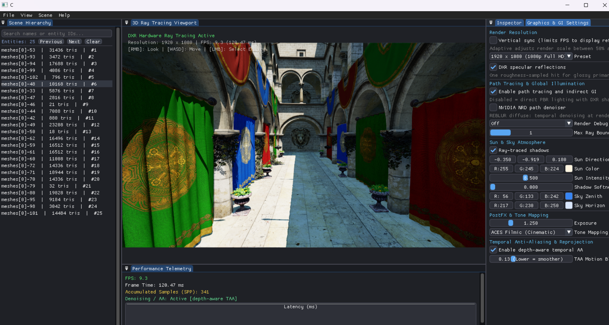
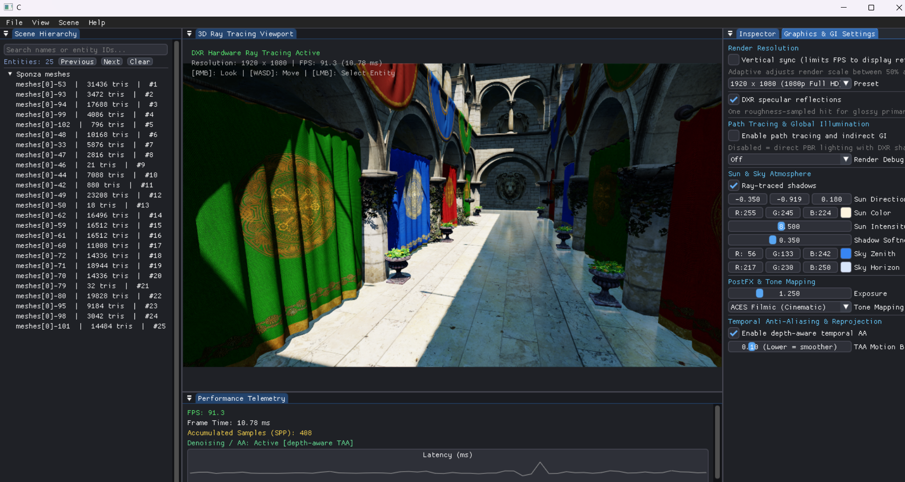
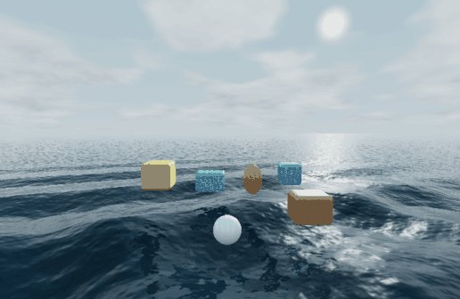

# Custom DX12 Ray-Tracing Engine

A Windows C++20 editor and renderer built on Direct3D 12 and DXR. The checked-in demo scenes are Sponza and a separate Jolt-driven ocean. Khronos glTF sample content exercises metallic/roughness materials. This is a compact engine project, not a full O3DE distribution.

## Implemented features and scope

| Area | Implementation | Scope and limits |
| --- | --- | --- |
| Direct renderer | Metallic/roughness PBR, directional sun, analytic sky, DXR shadow queries, soft-shadow sampling, exposure and tone mapping | D3D12 with hardware DXR Tier 1.0 or later |
| DXR reflections | One non-recursive scene query for eligible glossy surfaces; GGX visible-normal sampling; alternating half-rate schedule with inverse-probability compensation | Same editor control works in Sponza, Khronos material lab, and ocean. Water retains analytic-sky reflection as fallback |
| GI / path tracing | Progressive diffuse path tracing, cosine sampling, Sobol/Owen per-pixel sequence, configurable 1–4 secondary bounces, Russian roulette | One stochastic path sample per pixel per GI frame. GI is slower than direct rendering and needs accumulation |
| Denoising | Optional NVIDIA NRD REBLUR diffuse and specular lobes with separate signals, material factors, normal/roughness, depth, hit-distance, and camera reprojection guides | Built-in accumulation and edge-aware display filter are used when NRD is disabled or unavailable; they are not an NRD replacement |
| NVIDIA DLSS | Optional DLSS Super Resolution (SR) and Ray Reconstruction (RR) using NGX D3D12 | SR and RR are exclusive; RR supersedes NRD. Per-object animated motion vectors are not implemented, so use these features with static scenes |
| Temporal processing | Temporal accumulation/reprojection for supported static-scene paths; tone mapping and exposure | No general post-effect graph, bloom, depth of field, or motion blur |
| Materials and import | glTF/GLB and Assimp import paths; base color, metallic/roughness, normal, and emissive textures; mip generation | Missing authored maps use explicit material fallbacks; fallbacks do not recreate the original source maps |
| ECS/editor | Scene entity list, hierarchy filtering and selection, inspector, transform editing, material overrides, world-space triangle picking, visible XYZ selection gizmo | Entities and render data still use bounded scene/render arrays; no general component pools or editable parent graph |
| Ocean | Analytic multi-wave surface, Jolt rigid bodies, buoyancy support, wakes, persistent volume-balanced body displacement, foam and Fresnel/GGX shading | Coupled demonstration model, not a Navier–Stokes fluid solver or displaced DXR mesh |
| Physics | Jolt 5.3 through a narrow C ABI bridge built with MSYS2 UCRT64 | Separates MSYS2 C++ ABI from the MSVC engine |
| RTX SDKs | NRD and NRI integrated; DLSS SDK optional | RTXDI/ReSTIR, RTXGI, RTXPT, RTXMG, RTXMU, and RTXNTC are not linked or invoked |

## Screenshots and water sequence

These Sponza editor screenshots were supplied for the repository. Their FPS overlays are readings from those captures, not benchmarks.

The ocean preview is assembled from a 60 Hz Jolt simulation at 30 frames per second. It shows entry, rebound, and water response. DXR uses a flat broad-phase water proxy; the closest-hit shader corrects the hit against the analytic height field.

## Verification snapshot: 2026-11-03

Tests and captures were run on this Windows machine with an NVIDIA RTX 3050 Laptop GPU. Resolution-sensitive capture suites used 1920x1080 output. Short GPU timing windows vary with driver, power mode, clock, temperature, editor layout, and background load; the numbers below are observations, not performance guarantees.

| Check | Observed result |
| --- | --- |
| Release build | CustomEngine, EngineMathTests, and EngineGltfImportTests built successfully |
| CTest | 2/2 registered tests passed |
| Sponza capture suite, NRD on | 9/9 milestones passed at 1920x1080; direct + DXR shadows about 50.18 FPS; GI about 8.81 FPS |
| Sponza capture suite, NRD off | 9/9 milestones passed at 1920x1080; direct about 101.90 FPS; GI about 9.53 FPS |
| Sponza DXR reflection A/B | On/off/restored repeatability passed. Overall 8.43% changed (mean channel delta 1.141); floor ROI 33.82% (mean 4.124); pillar ROI 2.55% (mean 0.352); restored error 0.0003 mean / 0.003% changed. Reflection on/off timing 97.84/132.90 FPS |
| Ocean DXR reflection A/B | All captures 1920x1080. Fixed blue-water mask: 4.77% of 770,107 pixels changed; mean channel delta 2.704 |
| Jolt body-water displacement A/B | 25.44% of 65,785 water-neighborhood samples changed with body displacement enabled |
| Jolt ocean sequence | Six bodies; 5.98336 seconds simulated; maximum recorded vertical displacement 5.04415 m |
| DLSS SR | NGX feature created and evaluated at 1280x720 input to 1920x1080 output in the capture suite |
| DLSS RR | NGX feature created and evaluated at 1280x720 input to 1920x1080 output; native rendering selected for unsupported debug modes |
| ECS selector | Fresh 1080p editor capture visibly contains selection bounds and red/green/blue XYZ axes |
| Static checks | Python runner/tool byte-compilation and git diff whitespace check passed |

The reflection tests use fixed scenes and on/off/restored image comparisons. A changed-pixel ratio establishes a measurable contribution, not perceptual correctness by itself. The water comparison isolates a fixed blue-water mask. The captured ocean has a blue-gray appearance under the tested overcast sky and lighting; the preview is an analytic demo, not a production ocean. Path tracing remains slower and can be noisy at low sample counts. These results do not prove the engine defect-free or guarantee behavior on other GPUs and drivers.

## DXR reflection estimator

For isotropic GGX roughness r, the shader uses alpha = max(r squared, 0.0025) and samples the visible normal distribution. With unit normal N, view V, reflected direction L, half vector H, GGX distribution D, and masking term G1, the reflected-direction probability density is:

~~~
p(L | V) = D(H) G1(V) / (4 (N dot V))
~~~

Cook–Torrance GGX evaluates:

~~~
fr = D(H) G1(V) G1(L) F(V,H) / (4 (N dot V)(N dot L))
~~~

The Monte Carlo contribution is fr times (N dot L) divided by p(L|V). Cancelling common terms yields F(V,H) G1(L). The renderer traces one of each consecutive eligible sample pair. A per-pixel hash chooses the pair phase; accepted samples receive weight 1 / 0.5 = 2. This preserves the expectation while halving eligible reflection queries over a full pair. The C++ math test compares the original ratio with the simplified expression over roughness, cosine, and Fresnel grids.

## Render architecture

~~~
                         +----------------------------+
 glTF / Assimp assets -->| Scene entities + materials |
                         +--------------+-------------+
                                        | transforms and uploads
                         +--------------v-------------+
                         | D3D12 buffers and textures |
                         | BLAS per mesh; TLAS per frame|
                         +--------------+-------------+
                                        |
             +--------------------------+--------------------------+
             |                          |                          |
       Direct PBR                 Path tracing                Ocean scene
    sun + DXR shadows           diffuse bounce loop            Jolt + waves
             |                          |                          |
             +--------------------------+--------------------------+
                                        |
                           optional DXR reflection query
                                        |
                    +-------------------v---------------------+
                    | NRD or native accumulation / filtering  |
                    | DLSS SR or RR when active and supported  |
                    +-------------------+---------------------+
                                        |
                          exposure -> tone map -> sRGB output
                                        |
                                ImGui and present
~~~

### Frame and resource rules

- The Win32 loop polls input, advances fixed-step physics, updates camera/scene state, builds frame constants, submits D3D12 work, and presents.
- Each in-flight frame has transient upload allocations. A D3D12 fence retires them only after GPU completion.
- BLAS inputs use validated vertex/index ranges. TLAS instance transforms and 24-bit fields are validated before upload. Update and rebuild paths maintain explicit acceleration-structure capacity.
- Color, depth, motion, denoiser guides, and output images transition between D3D12 resource states around producer/consumer passes. Resize waits for in-flight GPU work before replacing size-dependent resources.
- NRD receives its signal and guide formats. DLSS status becomes active only after NGX feature creation and evaluation; failure or unsupported debug modes select the native path.
- Mouse pixels are mapped into the fitted viewport, unprojected with DirectX depth [0,1], then used for world-space triangle picking. Selection bounds and XYZ axes draw over the viewport image.

## Lighting and sampling equations

### Lambert diffuse and metallic response

For linear albedo c, metallic factor m, Fresnel term F, and unit normal N, the diffuse BRDF is:

~~~
fd = (1 - m) c / pi
~~~

For incident radiance Li, visibility V, and direction L:

~~~
Ldirect,diffuse = Li V max(N dot L, 0) fd
~~~

Direct specular uses GGX microfacet distribution, Smith masking-shadowing, and Schlick Fresnel. Color textures are converted from sRGB before lighting; data maps remain linear.

### Cosine sampling and path throughput

A cosine hemisphere sample has probability density p(w) = cos(theta)/pi. In the diffuse path estimator, cosine and PDF cancel the Lambertian factor. Throughput multiplies by linear diffuse reflectance, including the non-metal/Fresnel factors used by the shader. Russian roulette continuation divides by its survival probability, preserving the estimator expectation. A finite radiance cap of 250 limits fireflies and deliberately trades bias for lower variance. Each GI frame contributes a low-discrepancy sample per pixel, so convergence takes time.

Direct sun is evaluated using a visibility ray. The analytic sun disk is used on camera-primary environment misses, not as a bright emitter on every diffuse path miss. Diffuse path misses use preconvolved irradiance divided by pi, the expected incoming radiance under cosine sampling.

### Camera depth and reprojection

For a left-handed D3D perspective projection with near n, far f, and positive view-space depth z, forward hardware depth is:

~~~
d = f/(f-n) - fn/((f-n)z)
~~~

Static-scene motion derives from current and previous projected positions. It is expressed in render-pixel units; current jitter is supplied separately to NGX. Depth and motion use the active feature input resolution. Ocean animation paths without correct per-object motion disable temporal features that would ghost.

## Ocean waves and buoyancy

The ocean sums deterministic directional waves. For wave i, amplitude Ai, wave number ki, unit direction di, angular frequency wi, phase phi_i, horizontal location x, and time t:

~~~
theta_i = ki (di dot x) - wi t + phi_i
h(x,t) = sum Ai sin(theta_i)
grad(h) = sum Ai ki cos(theta_i) di
n = normalize((-dh/dx, 1, -dh/dz))
~~~

Jolt bodies sample wave height and gradient at fixed simulation steps. Oriented support approximates each body's projected footprint along the surface normal. Each submerged body adds a radial depression and positive outer ridge. Ridge amplitude balances the profile integral to approximately zero over its support radius, preserving displaced volume in the height field. Entry events add a decaying radial wake. This creates visible coupling, but does not solve fluid pressure, splash droplets, or two-way momentum transfer into the rigid-body solver.

Water's DXR geometry is a broad-phase flat proxy. Closest-hit performs bounded corrections against y - h(x,z,t) = 0 and uses the analytic gradient for the corrected normal. It improves reflection intersection without rebuilding a tessellated wave mesh into the acceleration structure.

## ECS, picking, and numeric safeguards

- Entity IDs use checked lookup. Imported glTF primitives retain source-node paths for hierarchy grouping.
- Picking reconstructs a world ray from client pixels and camera matrices, rejects singular transforms, then tests world-transformed triangles. The displayed outline is an AABB and can include empty space.
- Gizmo size follows camera distance. It is clipped to the viewport and tries both axis directions near the depth limit.
- AABB slab intersections use double intermediates and exact-zero parallel handling. Vector length uses hypot to avoid overflow from squaring large finite components.
- glTF normals use double-precision inverse-transpose/cofactor math. Singular/non-finite transforms are rejected, and mirrored transforms preserve orientation.
- Image readback checks dimensions and byte-size arithmetic. D3D12 texture rows use the required 256-byte alignment.
- Timing uses a monotonic clock, rejects invalid deltas, and limits camera movement after long stalls.

## Build and dependencies

### Requirements

- Windows 10/11 x64, Visual Studio 2022 C++ workload, Windows SDK.
- CMake 3.30 or newer and Python 3.
- D3D12 GPU with hardware DXR Tier 1.0 or later for ray tracing.
- MSYS2 UCRT64 for Jolt 5.3 and MSYS2 MINGW64 runtime for Assimp.
- Pillow is optional for rebuilding the curated GIF.

### Configure and build

~~~
cmake -S . -B build -G "Visual Studio 17 2022" -A x64
cmake --build build --config Release --target CustomEngine EngineMathTests EngineGltfImportTests -j 6
ctest --test-dir build -C Release --output-on-failure
~~~

To omit NVIDIA NRD or DLSS locally:

~~~
cmake -S . -B build -DENGINE_ENABLE_NRD=OFF -DENGINE_ENABLE_DLSS=OFF
~~~

The default build uses NRD/NRI source from vendor/nvidia. Optional DLSS uses NVIDIA's proprietary SDK; use it under its license and do not redistribute SDK binaries unless allowed. If the SDK cannot be fetched, configure with ENGINE_ENABLE_DLSS=OFF. Jolt builds as a small UCRT64 C ABI DLL. Assimp and matching MinGW runtime dependencies are staged beside the application; keep each toolchain's DLL family together.

### Executables and controls

build/Release/CustomEngine.exe opens Sponza. build/Release/WaterDemo.exe opens the same editor and renderer with the ocean loaded. The Scene menu switches between Sponza, ocean, and the Khronos reflection material lab. The executables need their staged assets and runtime DLLs.

The editor opens in direct lighting for interaction. Graphics & GI Settings controls GI, NRD, bounce count, shadows, sun/sky, exposure, tone mapping, TAA, output resolution, DXR reflections, and DLSS. SR and RR toggles are mutually exclusive. RR supersedes NRD. The render scale controls DLSS input size; output resolution remains the selected display size.

### Capture suites

~~~
python capture_runner.py --native-resolution build/Release/CustomEngine.exe
python capture_runner.py --native-resolution --no-nrd build/Release/CustomEngine.exe
python reflection_capture_runner.py --scene sponza --native-resolution build/Release/CustomEngine.exe
python ocean_capture_runner.py --native-resolution --compare-reflections build/Release/CustomEngine.exe
python ocean_capture_runner.py --native-resolution --compare-body-displacement build/Release/CustomEngine.exe
~~~

For DLSS, run one feature per session:

~~~
build/Release/CustomEngine.exe --test --native-resolution --dlss-sr
build/Release/CustomEngine.exe --test --native-resolution --dlss-rr
~~~

This machine initialized NGX with the engine's custom-engine Project ID and evaluated both SR and RR at 1280x720 input / 1920x1080 output. An NVIDIA-issued Application ID is optional for this initialization path. A fork should use its own stable project identifier. NGX support is hardware/driver-dependent; feature creation/evaluation failure uses native output. RR should be used with static scenes because object animation motion is not yet implemented.

The capture suites exercise selected frame-loop, render, import, physics, and image-comparison paths. Their fixed cases do not cover every asset, input sequence, GPU, or driver.

## Measured performance

Single-machine observations on an RTX 3050 Laptop GPU, output at 1920x1080. Timings are short-window averages and are not guaranteed frame rates.

| Mode | Approx. FPS | Conditions |
| --- | ---: | --- |
| Direct + DXR shadows, NRD enabled | 50.18 | Sponza capture suite |
| Path-traced GI, NRD enabled | 8.81 | Same run |
| Direct, NRD disabled | 101.90 | Separate run, not directly comparable |
| GI, NRD disabled | 9.53 | Separate run |
| Sponza reflections on / off | 97.84 / 132.90 | Separate fixed-camera A/B run |

The available RTX 3050 did not meet a high-FPS target for path tracing. Use direct mode for interactive editing and treat GI as a slower convergence mode.

## Project layout

~~~
src/core/        Math, timing, window, image capture
src/ecs/         Scene entities, asset import, transforms and picking
src/editor/      ImGui editor, viewport, inspector, selection gizmo
src/physics/     Ocean/Jolt bridge and water interaction
src/rhi/         D3D12 device, acceleration structures, NRD, DLSS
shaders/         Direct, path-tracing, reflection and composite HLSL
tests/           C++ math and glTF import regression checks
tools/           Jolt bridge and build/capture utilities
docs/media/      Curated screenshots and water preview
vendor/          Third-party dependencies and license notices
~~~

## Credits and licensing

The repository is licensed under the MIT License; see LICENSE.

O3DE Atom / Amazon Lumberyard was a read-only reference for the local DX12 acceleration-structure layout and renderer integration patterns. No O3DE source files were copied into this project. Relevant code comments give local attribution, and the reference checkout is not a build dependency.

Other dependencies retain their own terms: NVIDIA NRD/NRI and DLSS SDK under their NVIDIA terms; Jolt Physics MIT; Assimp BSD; Dear ImGui MIT; stb_image terms in its source header; Khronos sample asset license in the adjacent metadata; O3DE Apache-2.0.

RTXDI/ReSTIR, RTXGI, RTXPT, RTXMG, RTXMU, and RTXNTC are not integrated. Skeletal animation, a general post-effect graph, and a full O3DE Atom feature set are not implemented. This repository's MIT license does not replace third-party notices.
